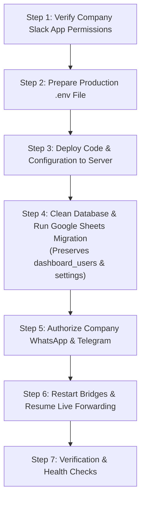

# BitLink — Complete Production Migration & Cut-Over Playbook

This master guide walks you through migrating your company's running BitLink system from Google Sheets to the PostgreSQL-backed BitLink Sales CRM on production server **`173.212.215.140`** (`/opt/bitlink-sales`).

### Core Guarantees of This Migration
1. **Zero Downtime for Existing Conversations:** All existing client channels on Slack (especially on the delivery side) remain mapped and resume bidirectional message forwarding immediately.
2. **`dashboard_users` & `settings` Are Never Deleted:** Your active admin login, passwords, and custom system settings are **100% preserved**.
3. **Single-Sheet Compatibility:** Seamlessly imports your single-sheet Google Spreadsheet (`client name`, `platform`, `external id`, `slack channel id`, `paused`) and populates both the **Delivery Client Mappings** and the **Sales Contacts Directory / CRM**.
4. **Existing Docker Database Reused:** Reuses the PostgreSQL database already running in Docker (`db:5432` volume `pg_data`) without wiping container volumes.
5. **Clean Switch to Company Accounts:** Complete instructions to disconnect personal test numbers and authorize the company's official WhatsApp and Telegram accounts.

---

## Migration Workflow Overview



---

## Step 1: Verify Company Slack App Permissions

Before touching the server or database, ensure your company's existing Slack Apps have the full set of OAuth scopes and permissions required by the new BitLink platform.

BitLink connects to **3 distinct Slack Bot Apps**:
* **App 1 (WhatsApp Bridge):** `SLACK_BOT_TOKEN`, `SLACK_APP_TOKEN`
* **App 2 (Telegram Bridge):** `SLACK_BOT_TOKEN_TELEGRAM`, `SLACK_APP_TOKEN_TELEGRAM`
* **App 3 (BitLink Manager):** `MANAGER_SLACK_BOT_TOKEN`, `MANAGER_SLACK_APP_TOKEN`, `MASTER_SLACK_BOT_ID`

---

### 1.1 App 1: Company WhatsApp Bridge Bot
Open **[api.slack.com/apps](https://api.slack.com/apps)** → Select your **WhatsApp Bridge App**.

#### A. Bot Token Scopes (`OAuth & Permissions` → `Scopes` → `Bot Token Scopes`)
Add these scopes:
* `chat:write` — Post incoming WhatsApp messages into Slack channels.
* `chat:write.customize` — Display custom client names and profile avatars on messages.
* `channels:history` — Read outbound messages written by team members in public channels.
* `channels:read` — Look up public channel information and member lists.
* `channels:manage` — In-place channel renaming (`conversations.rename`) and archiving.
* `channels:join` — Automatically join public channels.
* `groups:history` — Read outbound messages written by team members in **private** channels.
* `groups:read` — Look up private channel information.
* `groups:write` — In-place channel renaming and archiving for private channels.
* `files:write` — Upload media (images, PDFs, voice notes, documents) received from WhatsApp into Slack.
* `files:read` — Download media uploaded by team members in Slack to forward to clients.
* `reactions:write` — React with :white_check_mark: when messages reach the client and :x: on failure.
* `reactions:read` — Verify message reactions.
* `im:history`, `im:write`, `im:read` — Direct notifications to sales reps.
* `users:read` — Resolve Slack User IDs to team member names.

#### B. Socket Mode & App-Level Token (`Basic Information`)
* Navigate to **Socket Mode** → Toggle **Enable Socket Mode** to **ON**.
* Navigate to **Basic Information** → **App-Level Tokens** → Click **Generate Token and Scopes**:
  * Token Name: `socket-mode`
  * Add Scope: `connections:write`
  * Copy the token starting with `xapp-...` (This is your `SLACK_APP_TOKEN`).

#### C. Event Subscriptions (`Event Subscriptions`)
* Toggle **Enable Events** to **ON**.
* Under **Subscribe to bot events**, add:
  * `message.channels`
  * `message.groups`
  * `message.im`
  * `app_mention`

---

### 1.2 App 2: Company Telegram Bridge Bot
Open **[api.slack.com/apps](https://api.slack.com/apps)** → Select your **Telegram Bridge App**.

#### A. Bot Token Scopes (`OAuth & Permissions` → `Scopes` → `Bot Token Scopes`)
Add these scopes:
* `chat:write` — Post incoming Telegram messages into Slack channels.
* `chat:write.customize` — Display custom client names and Telegram avatars.
* `channels:history` — Read team messages in public channels to forward to Telegram.
* `channels:read` — Look up public channels.
* `channels:manage` — In-place channel renaming and archiving.
* `channels:join` — Join public channels.
* `groups:history` — Read team messages in **private** channels.
* `groups:read` — Look up private channels.
* `groups:write` — In-place channel renaming and archiving for private channels.
* `files:write` — Upload Telegram media into Slack.
* `files:read` — Download media uploaded in Slack to forward to Telegram.
* `reactions:write` — React with :white_check_mark: on successful delivery.
* `reactions:read` — Verify message reactions.
* `im:history`, `im:write`, `im:read` — Direct notifications.
* `users:read` — Resolve Slack User IDs.

#### B. Socket Mode & App-Level Token (`Basic Information`)
* Enable **Socket Mode** (ON).
* Generate App-Level Token with `connections:write` scope (`xapp-...`, saved as `SLACK_APP_TOKEN_TELEGRAM`).

#### C. Event Subscriptions
* Subscribe to bot events: `message.channels`, `message.groups`, `message.im`, `app_mention`.

---

### 1.3 App 3: Company BitLink Manager Bot
Open **[api.slack.com/apps](https://api.slack.com/apps)** → Select your **BitLink Manager App**.

#### A. Bot Token Scopes (`OAuth & Permissions` → `Scopes` → `Bot Token Scopes`)
* `commands` — Allows team members to run slash commands (`/handoff`, `/sales-snippet`, `/enhance`).
* `chat:write` — Post interactive modals and lead cards.
* `chat:write.public` — Post in public channels without prior invite.
* `channels:read`, `groups:read` — Read channel lists.
* `users:read` — List sales pool reps and project managers.
* `im:write` — Send direct messages and interactive notifications.

#### B. Socket Mode & App-Level Token
* Enable **Socket Mode** (ON).
* Generate App-Level Token with `connections:write` scope (`xapp-...`, saved as `MANAGER_SLACK_APP_TOKEN`).

#### C. Slash Commands Registration (`Slash Commands`)
Register these 3 commands:
* `/handoff` — Transfers lead ownership to another rep.
* `/sales-snippet` — Opens quick snippets modal to insert sales templates.
* `/enhance` — AI-drafts an intelligent reply based on conversation history.

#### D. Copy Master Bot Member ID (`MASTER_SLACK_BOT_ID`)
* In your Slack workspace, click the **BitLink Manager** bot profile → Click `...` (More options) → **Copy member ID** (format: `U0...`). Save as `MASTER_SLACK_BOT_ID`.

---

### 1.4 Crucial Step: Bot Membership in Existing Slack Channels
Because your delivery channels and sales channels are already created:
1. **Public Channels:** Bots can join and post automatically.
2. **Private Channels:** Bots **cannot read or post in private channels unless invited**.
   In each existing private channel, run:
   ```text
   /invite @BitLink WhatsApp Bridge
   /invite @BitLink Telegram Bridge
   /invite @BitLink Manager
   ```
   *(If you are using the same Slack bot tokens as your legacy BitLink, the bots are already present in these channels).*

---

## Step 2: Prepare Production Environment (`.env`)

Update `/Users/apple/Desktop/BitLink-Sales/bitlink/.env` with your company's credentials.

### Required `.env` File Format:

```bash
# ==============================================================================
# 1. SLACK CREDENTIALS (COMPANY WORKSPACE)
# ==============================================================================
# WhatsApp Bridge Bot
SLACK_BOT_TOKEN=xoxb-...
SLACK_APP_TOKEN=xapp-...

# Telegram Bridge Bot
SLACK_BOT_TOKEN_TELEGRAM=xoxb-...
SLACK_APP_TOKEN_TELEGRAM=xapp-...

# BitLink Manager Bot
MANAGER_SLACK_BOT_TOKEN=xoxb-...
MANAGER_SLACK_APP_TOKEN=xapp-...
MASTER_SLACK_BOT_ID=U0...

# ==============================================================================
# 2. TELEGRAM API CREDENTIALS (my.telegram.org)
# ==============================================================================
API_ID=...
API_HASH=...

# ==============================================================================
# 3. AI & DIGEST CONFIGURATION (Google AI Studio)
# ==============================================================================
GEMINI_API_KEY=AIzaSy...

# ==============================================================================
# 4. MICROSERVICES NETWORKING (DO NOT CHANGE)
# ==============================================================================
NODE_API_URL=http://gateway:3101
WHATSAPP_REFRESH_PORT=8102
TELEGRAM_REFRESH_PORT=8004
CONTROL_DASHBOARD_PORT=5051
MAX_FILE_SIZE_MB=500
SESSIONS_DIR=sessions

# ==============================================================================
# 5. POSTGRESQL DATABASE (EXISTING DOCKER CONTAINER)
# ==============================================================================
DATABASE_URL=postgresql://bitlink:Abdulhanan111%40@db:5432/bitlink
DB_PASSWORD=Abdulhanan111@

# ==============================================================================
# 6. GOOGLE SHEETS MIGRATION CONFIGURATION
# ==============================================================================
SPREADSHEET_NAME=BitLink Client Mappings
SHEETS_CREDENTIALS_FILE=credentials/service_account.json
```

> [!IMPORTANT]
> If your Google Spreadsheet has a different title, update `SPREADSHEET_NAME` to match its exact title in Google Drive.

---

## Step 3: Deploy Code & Configuration to Server

Push the updated `.env` and migration logic to your server using the automated deploy script:

```bash
cd /Users/apple/Desktop/BitLink-Sales/bitlink
./deploy.sh 173.212.215.140
```

This synchronizes the repository to `/opt/bitlink-sales` and rebuilds the containers without affecting existing Docker database volumes.

---

## Step 4: Clean Database & Run Google Sheets Migration

This step clears test data while **strictly preserving your active admin user in `dashboard_users` and your system settings in `settings`**, and imports all your existing delivery clients and Slack channels.

### 4.1 Ensure Google Spreadsheet is Shared
Open your Google Sheet and share it with:
```text
bitlink-sa@bitlink-509011.iam.gserviceaccount.com
```
*(Permission: **Viewer** or **Editor**).*

### 4.2 Run the Migration Command
SSH into the server and run the migration inside the `dashboard` container:

```bash
ssh root@173.212.215.140
cd /opt/bitlink-sales

docker compose exec dashboard python3 migrate_sheets_to_pg.py --allow-truncate
```

### What Happens Automatically:
1. **Targeted Truncate:**
   * Cleans: `client_mappings`, `sales_leads`, `sales_pool`, `blocklist`, `project_managers`, `snippets`, `critical_alerts`, `alert_details`.
   * **PRESERVED:** `dashboard_users` (your admin account is 100% safe) and `settings` (all system settings kept).
2. **Flexible Column Parsing:**
   * Reads your single-sheet columns: `client name`, `platform`, `external id`, `slack channel id`, `paused` (handles spaces, underscores, and mixed case automatically).
3. **Dual Insertion:**
   * **Delivery Client Mappings (`client_mappings`):** Every client is stored with their active Slack delivery channel ID.
   * **Sales Contacts Directory & CRM (`sales_leads`):** Every client is also seeded into `sales_leads` marked as `stage='won'` and `delivery_handed_off=True`, ensuring they appear in the **Sales Contacts Directory** and **Sales CRM Pipeline**.
4. **Instant Bridge Refresh:** An internal `/refresh` signal is triggered immediately to reload the mappings into active memory.

### 4.3 Verify Data Parity
Check that row counts match your Google Sheet:

```bash
docker compose exec dashboard python3 migrate_sheets_to_pg.py --verify
```

You should see:
```text
table                    sheets   postgres  status
-------------------------------------------------------
client_mappings              42         42  OK
sales_leads                  42         42  OK
sales_pool                    0          0  OK
blocklist                     0          0  OK
project_managers              0          0  OK
snippets                      0          0  OK
settings                      -         21  (preserved)
dashboard_users               -          2  (preserved)

value-level check: OK (compared client_mappings)
```

---

## Step 5: Authorize Company WhatsApp & Telegram

Now that the data and Slack bots are configured, remove your personal test credentials and authorize the company's official accounts.

### 5.1 Link Company WhatsApp (Baileys)
1. Stop the gateway and erase test credentials:
   ```bash
   cd /opt/bitlink-sales
   docker compose stop gateway
   rm -rf whatsapp-bot/baileys_auth_info/*
   docker compose start gateway
   ```
2. Stream gateway logs to view the QR code:
   ```bash
   docker compose logs -f gateway
   ```
3. Open WhatsApp on the **company's official phone** → **Linked Devices** → **Link a device** → Scan the QR code displayed in your terminal.
4. When connected, you will see:
   ```text
   ✅ [BAILEYS] Connection opened successfully!
   ```

### 5.2 Authorize Company Telegram (Telethon)
1. Stop the Telegram bridge and delete test sessions:
   ```bash
   docker compose stop tg-bridge
   rm -f sessions/*.session
   ```
2. Launch a one-time interactive login session:
   ```bash
   docker compose run --rm -it tg-bridge python3 -c "
   from telethon.sync import TelegramClient
   import os
   client = TelegramClient('sessions/telethon', int(os.getenv('API_ID')), os.getenv('API_HASH'))
   client.start()
   print('✅ Company Telegram authorized successfully!')
   "
   ```
3. Enter:
   * **Company Phone Number** (e.g. `+1...` or `+92...`)
   * **OTP Login Code** (sent to the company's Telegram app)
   * **2FA Password** (if set)
4. Start the Telegram bridge service:
   ```bash
   docker compose start tg-bridge
   ```

---

## Step 6: Restart Bridges & Resume Live Forwarding

Restart both bridge services so they bind to the fresh database mappings and company gateway sessions:

```bash
cd /opt/bitlink-sales
docker compose restart wa-bridge tg-bridge
```

### How Live Communication Resumes:
* **Existing Delivery Channels:**
  * When an existing client sends a message on WhatsApp or Telegram, BitLink matches their phone number or chat ID to the `slack_channel_id` imported from your sheet and immediately forwards it into that channel.
  * When team members reply in that Slack channel, BitLink captures the message, forwards it back to the client, and places a `:white_check_mark:` reaction on the Slack message upon successful delivery.
* **New Inbound Leads:**
  * If a new prospect messages for the first time, BitLink auto-provisions a new `#sale-wa-...` or `#sale-tg-...` channel and assigns a sales rep via round-robin.

---

## Step 7: Post-Migration Verification & Health Checks

### 7.1 Verify All 3 Slack Bots
Run this command on the server to verify all 3 Slack tokens are authenticating:

```bash
docker compose exec dashboard python3 -c "
import os
from dotenv import load_dotenv; load_dotenv()
from slack_sdk import WebClient

bots = [
    ('WhatsApp Bridge', os.getenv('SLACK_BOT_TOKEN')),
    ('Telegram Bridge', os.getenv('SLACK_BOT_TOKEN_TELEGRAM')),
    ('BitLink Manager', os.getenv('MANAGER_SLACK_BOT_TOKEN'))
]

for name, token in bots:
    try:
        res = WebClient(token=token).auth_test()
        print(f'✅ {name}: Connected as @{res[\"user\"]} (ID: {res[\"user_id\"]})')
    except Exception as e:
        print(f'❌ {name}: Authentication failed -> {e}')
"
```

### 7.2 Check Dashboard Web UI
1. Open **`https://bitlink-sales.duckdns.org`** in your browser.
2. Log in with your admin credentials (confirmed preserved).
3. Confirm system status badges in header:
   * **WhatsApp Bridge:** `Connected`
   * **Telegram Bridge:** `Connected`
   * **PostgreSQL Database:** `Connected`
4. Click **Delivery Clients**: Verify all clients from your Google Sheet appear with their assigned Slack channels.
5. Click **Sales Contacts Directory**: Verify all clients appear in the directory.

### 7.3 Live Relay Test
1. Write a message from Slack in an active delivery channel. Verify it arrives on the client's WhatsApp or Telegram and Slack reacts with `:white_check_mark:`.
2. Reply from WhatsApp or Telegram. Verify the reply appears in Slack with the client's custom display name.
